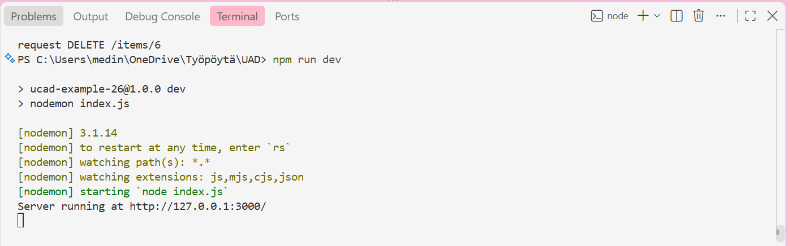
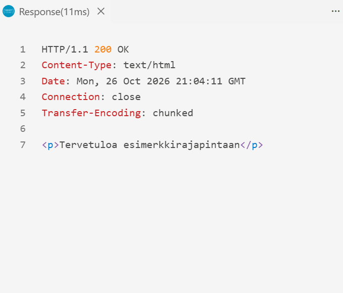
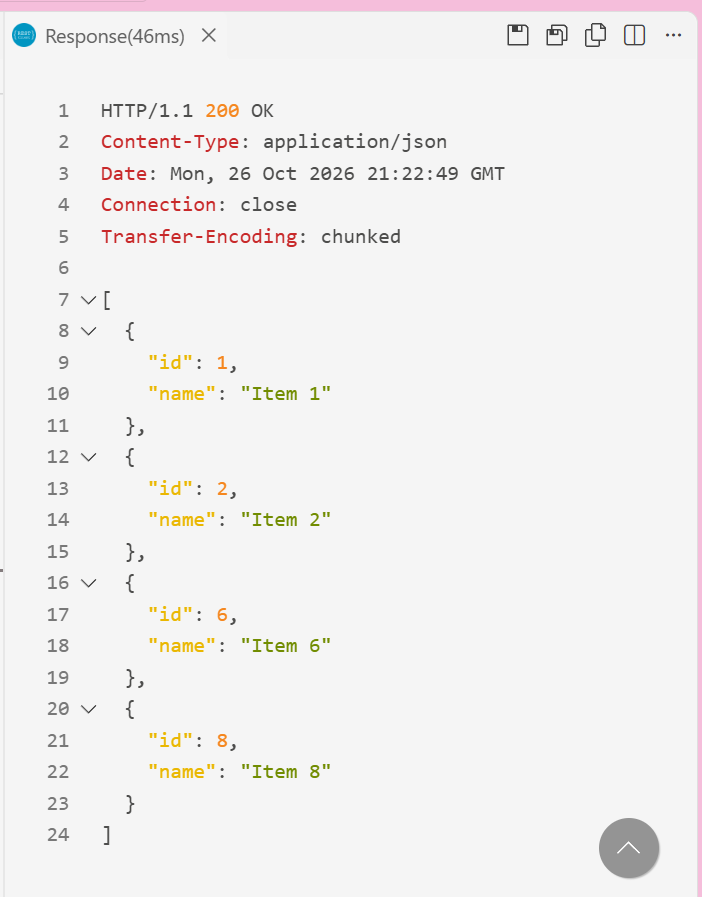
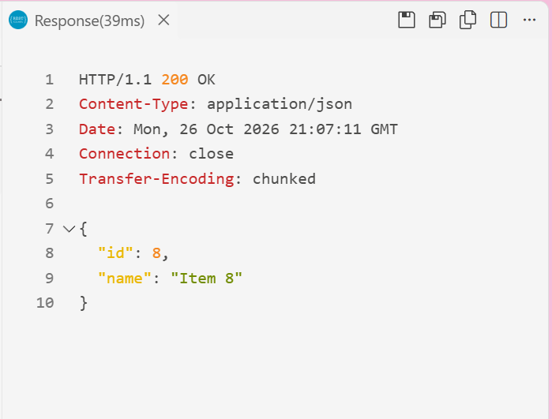
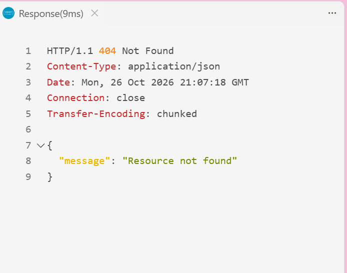
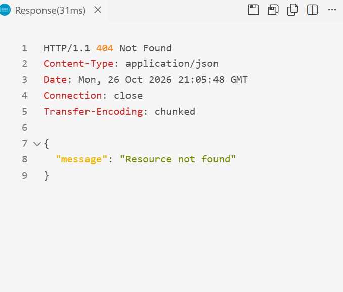
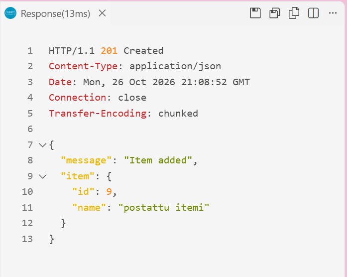
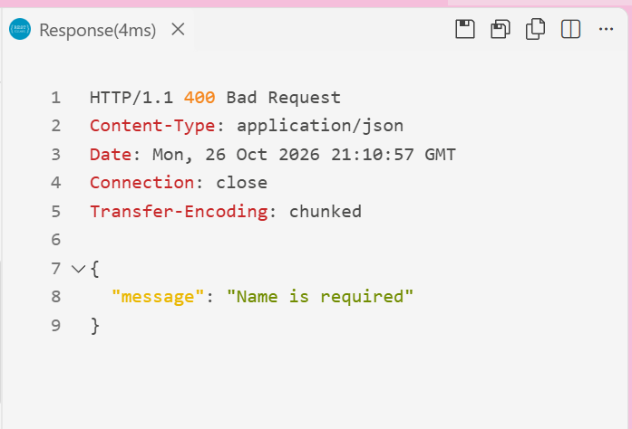
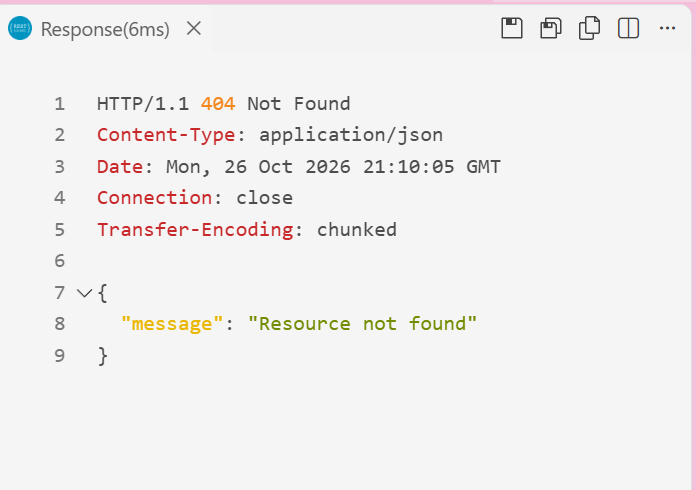

Linkki koodiin: 

## Käynnistysnpm 
install
npm run dev

Palvelin käynnistyy osoitteeseen http://localhost:3000

## API-dokumentaatio
GET, Ei sisältöä, 200: Tervetuloviesti HTML-muodossa
GET /items, Ei sisältöä, 200: Kaikki kohteet JSON-muodossa
GET/items/:id, Kohteen tunniste, 200: Kohteen tiedot, 404: Kohdetta ei löydy
POST/items, {"name": "Kohteen nimi"}, 201: Kohde lisätty, 400: Virheellinen JSON tai nimi puuttuu
PUT/items/:id, {"name": "Uusi nimi"}, 200: Kohde päivitetty, 400: Virheellinen JSON tai nimi puuttuu, 404: Kohdetta ei löydy
DELETE, /items/:id, Kohteen tunniste, 204: Kohde poistettu, 404: Kohdetta ei löydy

## Mitä sain tehtyä
Toteutin HTTP-palvelimen Node.js http-moduulilla. Tein GET-pyynnöt kaikkien kohteiden ja yksittäisen kohteen hakemiseen. Toteutin POST-pyynnön uuden kohteen lisäämiseen. Toteutin PUT-pyynnön olemassa olevan kohteen päivittämiseen. Toteutin DELETE-pyynnön kohteen poistamiseen.

## Ongelmat
Vaikeinta oli ymmärtää, miten eri asiat toimivat ja miksi niitä tarvitaan. Tehtävän tekeminen vei aikaa, ja ilman opettajan apua en olisi päässyt kunnolla alkuun. Työn edetessä opin kuitenkin lisää HTTP-pyynnöistä, rajapinnan toiminnasta ja virheiden käsittelystä.

## Kuvakaappaukset

